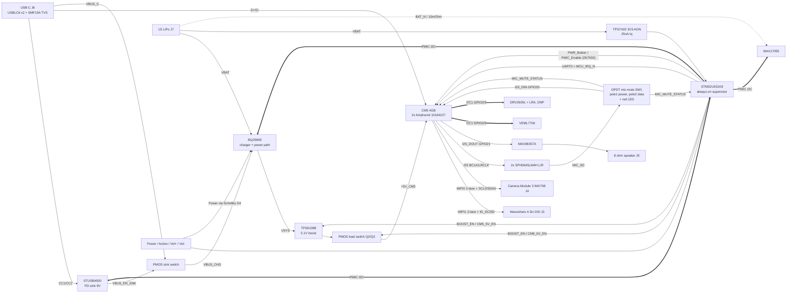
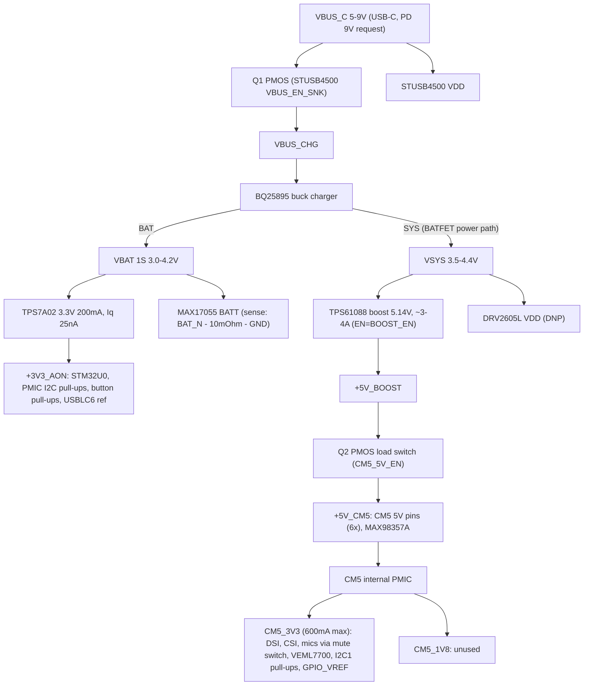

# PocketMate CM5 carrier: block diagram, power tree and power states (v0.1, 2026-10-21)
Schematic: `hardware/kicad/PocketMate.kicad_pro` (regenerate with `python3 hardware/kicad/gen/gen.py`).

## Block diagram

## Power tree

## Power-state table
| State | How entered | BATFET | VSYS | +3V3_AON / MCU | BOOST_EN / CM5_5V_EN | CM5 | Exit / wake |
|---|---|---|---|---|---|---|---|
| Ship mode (storage / force-off) | MCU sets BQ25895 BATFET_DIS over PMIC I2C after a 10 s Power hold, or as the last step of a shutdown | off | off (on battery) | **on**: the LDO sits on VBAT before the BATFET; MCU in Stop 2/Standby | low / low | off | USB-C insertion (BQ exits ship mode on VBUS) or Power press (QON pulled low through D4, no MCU involved) |
| Off (MCU standby) | CM5 shutdown completes, then MCU drops BOOST_EN and CM5_5V_EN | on | on | on, Stop 2 with EXTI wake on all 4 buttons | low / low | off | Power press (wake via EXTI), charger/gauge/PD alert |
| Charging while off | VBUS present while Off | on | on (from VBUS) | on | low / low | off | as above; charge LED D3 on |
| Booting | MCU sets BOOST_EN, waits for PG, then CM5_5V_EN; releases PMIC_Enable | on | on | on | high / high | boots | |
| Running | CM5_ALIVE heartbeat high | on | on | on (UART link to CM5) | high / high | on | |
| Soft shutdown | short Power press: MCU sends event over UART + MCU_IRQ_N, or pulses CM5 PWR_Button via Q4 | on | on | on | high until CM5_ALIVE low + timeout | shutting down | |
| Hard force-off | Power held 10 s (MCU only, no CM5 dependence) | off (BATFET_DIS) and/or on | off / on | on | forced low | power removed | as in Ship mode |

Mic mute: SW1 (DPDT slide). Pole 1 moves CM5_3V3 from MIC_VDD to MUTE_LED_PWR, which lights the red LED D1 and drives MIC_MUTE_STATUS high. Pole 2 grounds I2S_DIN, so the mics are cut in hardware twice and no software sits in the path.
